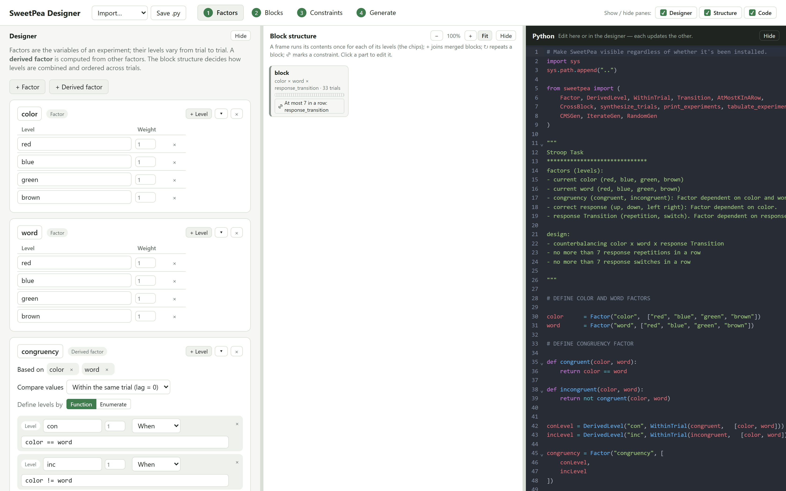
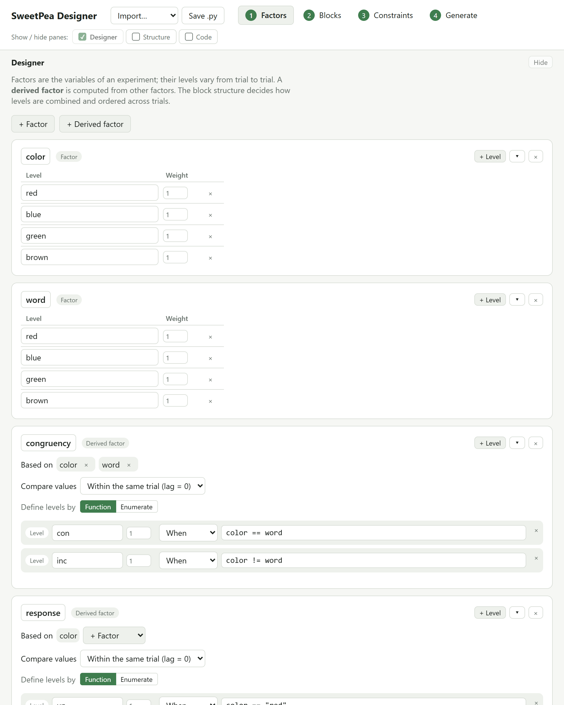
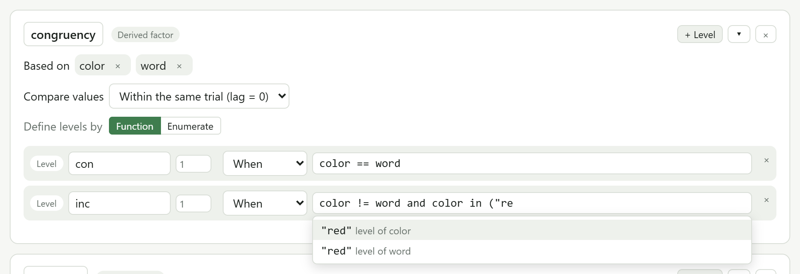
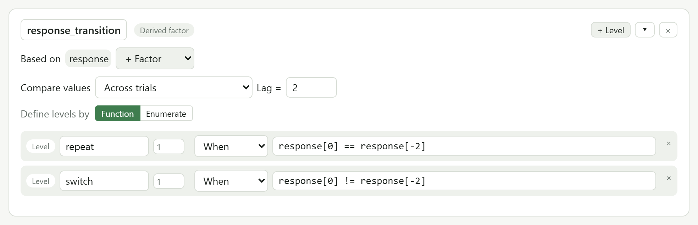
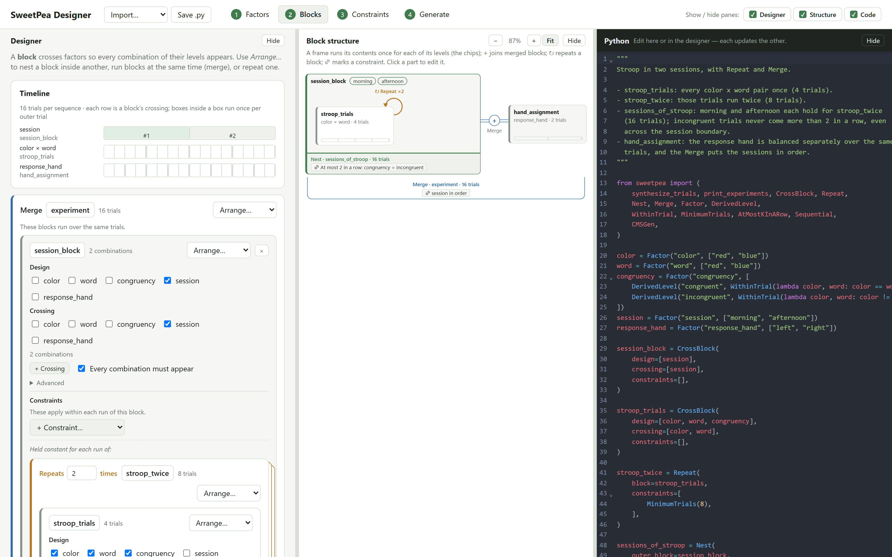
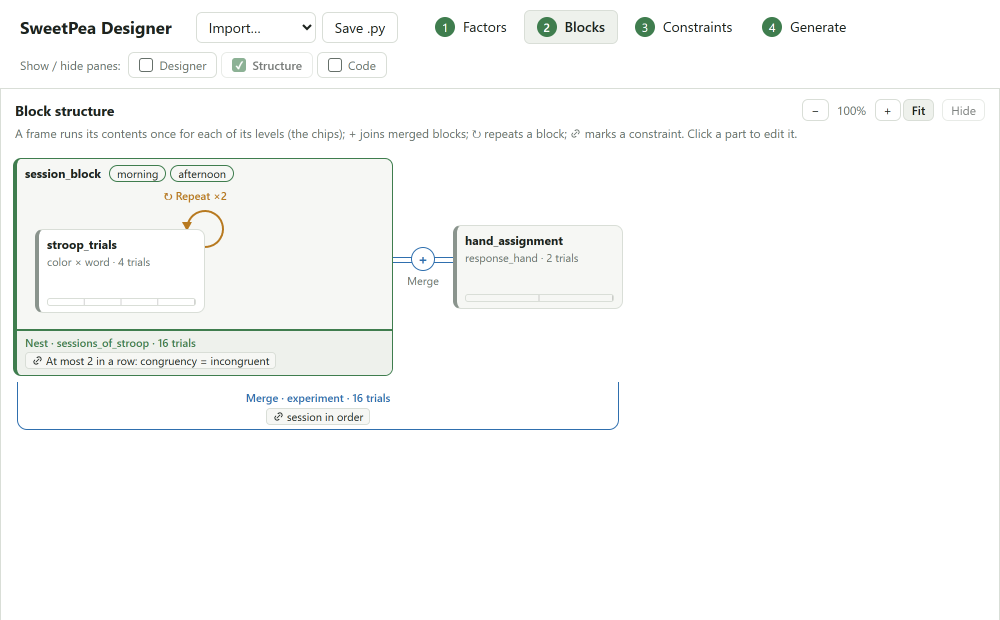
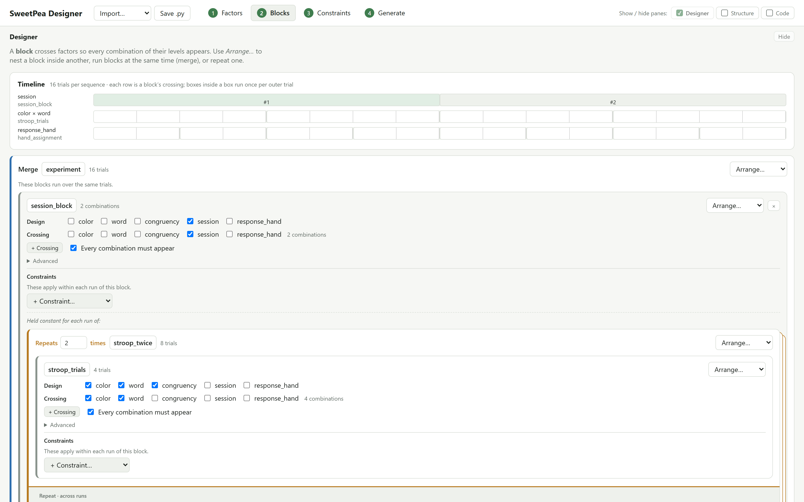
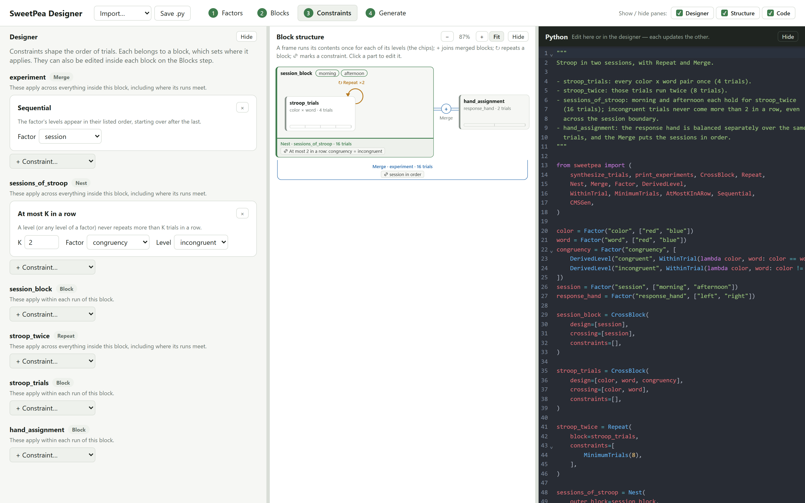
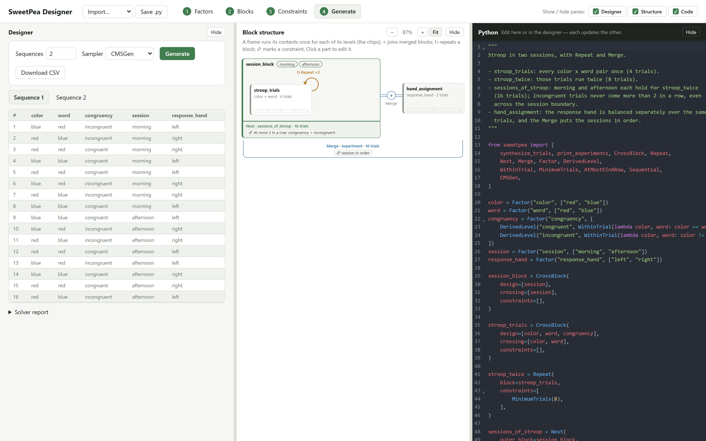
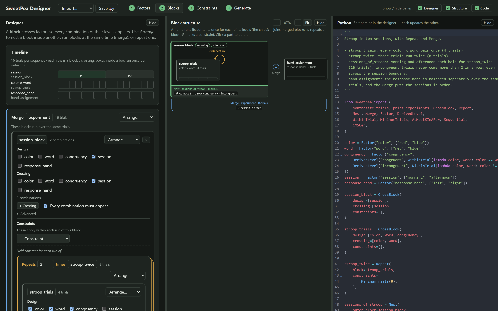

# SweetPea Designer: a preview

Screenshots of a graphical editor for SweetPea designs. You build the design
by clicking, and the Python code is written next to it; change either side
and the other follows. The four steps at the top are the same as in the
tutorial: factors, blocks, constraints, generate.

Click a picture to see it in full size.

## 1. Factors

Three panes side by side: the designer, the block structure as a picture, and
the Python code. Here a Stroop design is loaded: colour and word as factors,
congruency as a derived factor.

{ target=_blank }

The designer pane on its own. A factor is a list of levels, each with a
weight. A derived factor says which factors it is based on and when each of
its levels applies.

{ target=_blank }

The condition of a level is a short Python expression. The editor suggests
the levels of the factors it is based on.

{ target=_blank }

A derived factor can also look back across trials: here the response is
compared with the response two trials before.

{ target=_blank }

## 2. Blocks

A block crosses factors. Blocks can be put inside one another (nest), run
over the same trials (merge) or repeated. The timeline at the top left shows
which block covers which trials.

{ target=_blank }

The block structure as a picture: a frame runs its contents once for each of
its levels, a plus joins merged blocks, an arrow repeats a block, and a link
marks a constraint.

{ target=_blank }

The blocks editor on its own. For every block you tick which factors are in
the design and which are crossed.

{ target=_blank }

## 3. Constraints

Each constraint belongs to a block, which sets where it applies: within each
run of the block, or across everything inside it.

{ target=_blank }

## 4. Generate

Choose how many sequences and which sampler, generate, look at the trials as
a table, and download them.

{ target=_blank }

## Dark theme

{ target=_blank }
